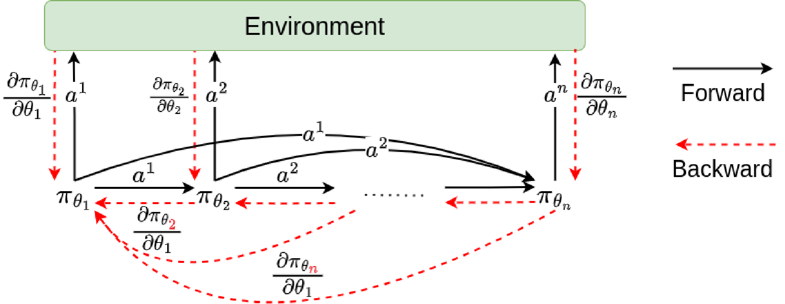
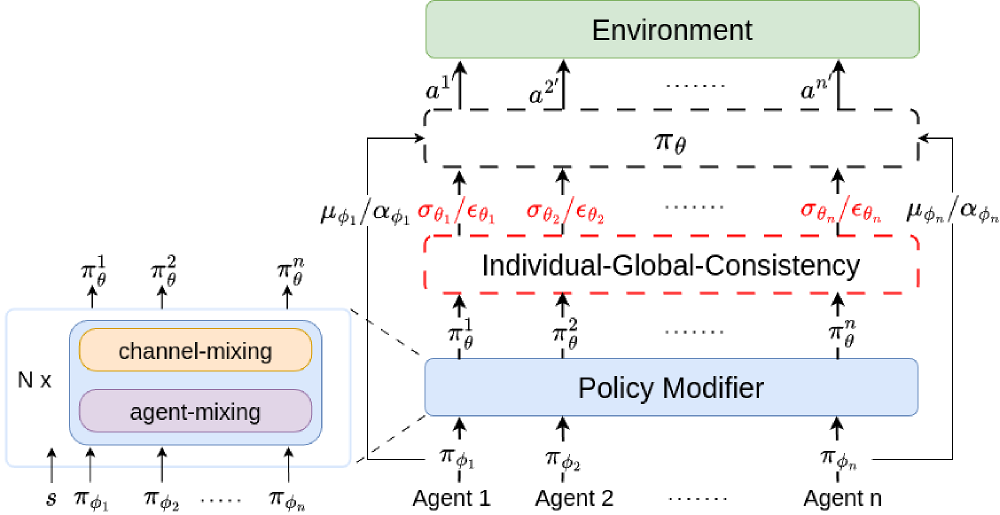

<div align="center">

# Backpropagation Through Agents & AgentMixer

**A unified research codebase for cooperative multi-agent reinforcement learning**

[](https://ojs.aaai.org/index.php/AAAI/article/view/29277)
[](https://ojs.aaai.org/index.php/AAAI/article/view/34048)
[](https://github.com/LiZhYun/BackPropagationThroughAgents/actions/workflows/core.yml)
[](LICENSE)

[Papers](#papers) · [Overview](#overview) · [Installation](#installation) · [Training & Evaluation](#training-and-evaluation) · [Documentation](#documentation) · [Citation](#citation)

</div>

This repository brings together **Backpropagation Through Agents (BPTA/BPPO)** and **AgentMixer** in a shared PyTorch implementation. Both methods study coordinated policy learning through structured interactions between agents: BPTA propagates learning feedback through autoregressive action dependencies, while AgentMixer combines individual policies through a centralized policy modifier.

The codebase provides explicit algorithm objectives, a common rollout and evaluation pipeline, discrete and continuous policies, and adapters for the benchmark environments used in the papers. Implementation decisions and corrections are documented alongside the corresponding methods.

## Papers

**Zhiyuan Li, Wenshuai Zhao, Lijun Wu, and Joni Pajarinen**

| Paper | Publication | Resources |
| --- | --- | --- |
| **Backpropagation Through Agents** | **AAAI 2024**, 38(12): 13718–13726 | [Paper](https://ojs.aaai.org/index.php/AAAI/article/view/29277) · [arXiv](https://arxiv.org/abs/2401.12574) · [PDF](https://arxiv.org/pdf/2401.12574) |
| **AgentMixer: Multi-Agent Correlated Policy Factorization** | **AAAI 2025**, 39(17): 18611–18619 | [Paper](https://ojs.aaai.org/index.php/AAAI/article/view/34048) · [arXiv](https://arxiv.org/abs/2401.08728) · [PDF](https://arxiv.org/pdf/2401.08728) |

### Backpropagation Through Agents

BPTA augments autoregressive policy learning with feedback from successor agents. Its **Bidirectional Proximal Policy Optimisation (BPPO)** algorithm combines each agent's own policy objective with a learning signal through its effects on subsequent decisions, updating actors in reverse execution order.

<p align="center">
  <a href="https://arxiv.org/abs/2401.12574">
    
  </a>
</p>
<p align="center"><em>BPTA framework from the paper: forward action dependencies and backward learning feedback.</em></p>

**Implementation:** [Discrete BPPO](src/bta_repro/bppo.py) · [Continuous BPPO](src/bta_repro/bppo_continuous.py) · [Objective and gradient conventions](docs/bppo.md)

### AgentMixer: Multi-Agent Correlated Policy Factorization

AgentMixer studies centralized policy construction from individual partially observable policies. A **policy modifier** combines local policy features with the global state, while **Individual–Global Consistency** connects the centralized policy's modes to local policy decisions for decentralized execution.

<p align="center">
  <a href="https://arxiv.org/abs/2401.08728">
    
  </a>
</p>
<p align="center"><em>AgentMixer architecture from the paper: centralized policy modification and Individual–Global Consistency.</em></p>

**Implementation:** [Discrete AgentMixer](src/bta_repro/agentmixer.py) · [Continuous AgentMixer](src/bta_repro/agentmixer_continuous.py) · [Parameterization and mode consistency](docs/agentmixer.md)

## Overview

### Algorithms

| Algorithm | Training mechanism | Execution information |
| --- | --- | --- |
| **MAPPO** | Independent actors with a centralized critic | Local observation |
| **AR-PPO** | Autoregressive policy optimization without peer feedback | Local observation and predecessor actions |
| **BPPO** | Autoregressive optimization with backward peer feedback | Local observation and predecessor actions |
| **AgentMixer** | Centralized policy modification with local policy learning | Local observation; the modifier is used during training |

The implementation keeps these execution contracts distinct. BPPO requires predecessor-action communication; AgentMixer evaluates local policies without the centralized modifier or global state.

### Benchmark environments

| Environment | Setup | Training and protocol guide |
| --- | --- | --- |
| Matrix games: Climbing and Penalty | Core dependencies | [Matrix-game protocols](docs/other_curve_targets.md) |
| Predator–Prey | Core dependencies | [Environment and evaluation protocol](docs/predator_prey_protocol.md) |
| Multi-Agent MuJoCo | Separate MuJoCo environment | [Installation](docs/mujoco_setup.md) · [Adapter semantics](docs/mujoco_adapter.md) |
| SMACv2 | Separate StarCraft II environment | [Installation and configuration](docs/smac.md) |
| Google Research Football | Separate Football environment | [Installation and configuration](docs/football.md) |

Temporal environments share rollout collection, advantage estimation, critic updates, evaluation and checkpointing. Matrix games provide a compact standalone entry point using the same policy and numerical components. Optional native engines are imported only when their environment is selected.

## Installation

The tested core environment uses **Python 3.11.15** and **PyTorch 2.6.0**. The checked-in `uv.lock` records the core dependency stack. Matrix games and Predator–Prey run with CPU PyTorch.

```bash
git clone https://github.com/LiZhYun/BackPropagationThroughAgents.git
cd BackPropagationThroughAgents

uv sync --locked --extra dev
source .venv/bin/activate
export OMP_NUM_THREADS=1 MKL_NUM_THREADS=1 OPENBLAS_NUM_THREADS=1
```

Install [uv](https://docs.astral.sh/uv/getting-started/installation/) before running these commands. For native simulators, follow the environment-specific guides above; their dependency profiles are intentionally separate from the core environment. See [tested runtime versions](docs/environment_versions.md) and [installation verification](docs/clean_checkout.md).

## Training and Evaluation

### Matrix games

Train BPPO on the Climbing game:

```bash
python -m bta_repro.train --algorithm bppo --game climbing \
  --steps 4096 --seed 0 --output results/bppo_example
```

Train the factorized, mode-consistent AgentMixer implementation:

```bash
python -m bta_repro.train --algorithm agentmixer --game climbing \
  --steps 4096 --seed 0 --output results/agentmixer_example
```

Use `--game penalty` for Penalty, or `--algorithm mappo` / `--algorithm arppo` for the corresponding baselines. These short examples exercise the complete training path; their budgets are not benchmark-performance settings.

### Temporal environments

Run AgentMixer on Predator–Prey using the provided configuration:

```bash
python -m bta_repro.simulator_train --config configs/prey_example.json \
  --output results/prey_example
```

Evaluate the saved policy:

```bash
python scripts/evaluate_simulator.py results/prey_example \
  --output results/prey_example_replay.json
```

The example trains for 10,240 joint environment decisions. Evaluation reports complete-episode diagnostics and the released 100 × 200-decision windows; the primary window score is `final_evaluation.fixed_window.reward_per_environment_step`. Evaluation interactions are recorded separately from training.

Each run writes its configuration, source hashes, metrics and checkpoint. Output paths must be new. The [configuration guide](configs/README.md) distinguishes single-run configurations from multi-run study plans; the [simulator training guide](docs/simulator_training.md) describes seeds, action masks, episode boundaries and saved-policy evaluation.

## Code Structure

```text
src/bta_repro/
├── core.py                    # PPO, GAE, batches and independent actors
├── bppo.py                    # Discrete autoregressive policies and peer feedback
├── bppo_continuous.py         # Continuous BPPO
├── agentmixer.py              # Discrete policy modifier and local execution
├── agentmixer_continuous.py   # Gaussian policy modifier
├── runner.py                  # Shared temporal rollout and update pipeline
├── train.py                   # Matrix-game training entry point
├── simulator_train.py        # Temporal-environment training entry point
└── checkpoint.py             # Model, optimizer and random-state persistence
```

Start with the matrix training loop, then read the method-specific policy module. The temporal trainer uses the same policy interfaces through the shared runner. Configuration files, executable utilities, numerical tests and method documentation are organized under [`configs/`](configs/README.md), [`scripts/`](scripts/), [`tests/`](tests/) and [`docs/`](docs/).

## Reproducibility and Implementation Notes

The numerical suite checks likelihood consistency, causal gradients, legal-action masks, mode preservation, local information isolation, termination/truncation handling and checkpoint replay. Run it with:

```bash
python -m pytest -q
```

The [core CI workflow](.github/workflows/core.yml) tests a built wheel and checks command-line execution and saved-policy replay outside the source checkout. [Validation records](docs/clean_checkout.md) identify the tested environment and distinguish implementation checks from learning-performance evidence.

This is a redesigned implementation of the papers' mechanisms. The BPPO surrogate makes the advantage, reduction and detach conventions explicit; discrete AgentMixer uses a positive gap-scaling parameterization to preserve policy modes. The default discrete modifier is factorized. Optional correlated modifiers, recurrent actors, Gaussian scale controls and auxiliary losses are labeled separately. See [method fidelity and corrections](docs/method_fidelity.md) for the equation-to-code mapping and scope of each variant.

Historical experiments and their limitations are retained in the [experiment tracker](refine-logs/EXPERIMENT_TRACKER.md). Example runs and numerical tests do not certify reproduction of every published benchmark score.

## Documentation

| Topic | Guide |
| --- | --- |
| Paper mechanisms and implementation choices | [Method fidelity](docs/method_fidelity.md) · [Accepted-source audit](docs/source_audit.md) |
| BPPO objectives | [Discrete BPPO](docs/bppo.md) · [Continuous BPPO](docs/bppo_continuous.md) |
| AgentMixer parameterizations | [Discrete AgentMixer](docs/agentmixer.md) · [Continuous AgentMixer](docs/agentmixer_continuous.md) |
| Training and evaluation | [Configurations](configs/README.md) · [Shared runner](docs/runner.md) · [Simulator training](docs/simulator_training.md) |
| Environment setup | [Runtime versions](docs/environment_versions.md) · [MuJoCo](docs/mujoco_setup.md) · [SMACv2](docs/smac.md) · [Football](docs/football.md) |
| Installation and correctness | [Clean installation](docs/clean_checkout.md) · [Contributing](CONTRIBUTING.md) |

## Citation

If you use this code or build on these methods, please cite the relevant papers:

```bibtex
@article{li2024backpropagation,
  title   = {Backpropagation Through Agents},
  author  = {Li, Zhiyuan and Zhao, Wenshuai and Wu, Lijun and Pajarinen, Joni},
  journal = {Proceedings of the AAAI Conference on Artificial Intelligence},
  year    = {2024},
  volume  = {38},
  number  = {12},
  pages   = {13718--13726},
  doi     = {10.1609/aaai.v38i12.29277},
  url     = {https://ojs.aaai.org/index.php/AAAI/article/view/29277}
}

@article{li2025agentmixer,
  title   = {{AgentMixer}: Multi-Agent Correlated Policy Factorization},
  author  = {Li, Zhiyuan and Zhao, Wenshuai and Wu, Lijun and Pajarinen, Joni},
  journal = {Proceedings of the AAAI Conference on Artificial Intelligence},
  year    = {2025},
  volume  = {39},
  number  = {17},
  pages   = {18611--18619},
  doi     = {10.1609/aaai.v39i17.34048},
  url     = {https://ojs.aaai.org/index.php/AAAI/article/view/34048}
}
```

When reporting results obtained with this implementation, include the repository commit, configuration and evaluation protocol.

## License

The source code is released under the [MIT License](LICENSE). External simulator packages retain their respective licenses. The framework figures above are reproduced from the authors' paper sources; see [figure attribution](docs/assets/README.md).
