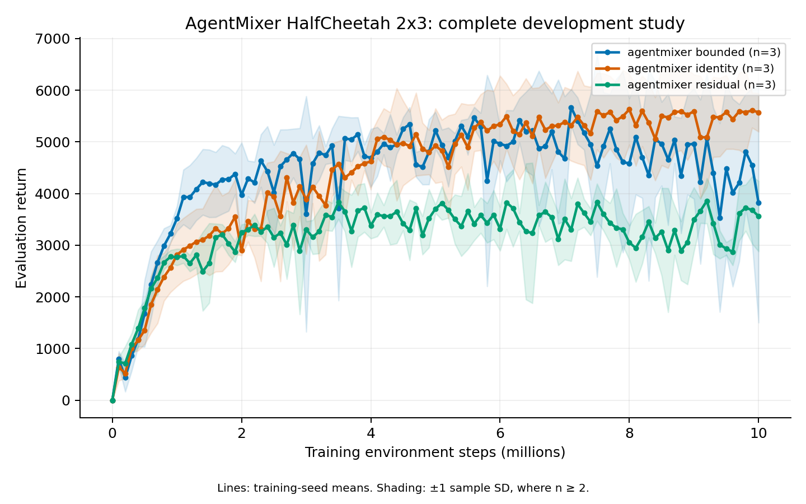

# AgentMixer HalfCheetah 10M development study

## Complete result — 2026-10-28

All nine runs complete validly. The learned modifiers underperform the identity control at the final scheduled checkpoint:

| Variant | Final return, mean ± sample SD | Normalized curve area, mean ± sample SD | Secondary 9.9M mean |
| --- | ---: | ---: | ---: |
| Bounded modifier | 3819.11 ± 2315.14 | 4411.01 ± 375.97 | 4543.90 |
| Residual modifier | 3560.85 ± 679.86 | 3190.57 ± 216.83 | 3680.95 |
| Identity control | 5569.45 ± 372.68 | 4435.61 ± 498.60 | 5609.87 |

Each row retains development seeds 0–2. The [comparison](../experiments/hc2x3_agentmixer10m_comparison_20261028.json) includes every endpoint and paired difference. The [raw audit](../experiments/hc2x3_agentmixer10m_complete_20261028.json) verifies 9,090 evaluation episodes and 22,500 updates. Both learned-modifier means remain below the figure range [5000, 5070]; the identity result cannot establish AgentMixer reproduction. The secondary 9.9M values do not replace 10M endpoints.

[PDF](figures/agentmixer10m_20261028.pdf). Shading is one sample SD across three development seeds. The bounded seed-0 endpoint is 1438.93; its decline remains included. Residual training distributions end with geometric standard deviations 2.26–2.65, versus 0.36–0.57 for bounded and 0.42–0.95 for identity. These observations motivate diagnosis; they do not prove the cause of the return gap.

The [completed diagnostic](../experiments/hc_agentmixer_final_diagnostic_complete_20261028.json) exactly replays all nine final policies and 90 raw episodes. Residual central scales hit their upper limit on 12.96–20.64% of evaluation action coordinates; identity seed2 hits it on 4.18%. Mean-action clipping is common in both learned and identity controls, so these observations do not prove the cause of the return gap. The original diagnostic's overstrict float32 scale assertion and the corrected rerun are both retained; no training artifacts changed.

Job **21252423** queues the [matched entropy-zero control](../experiments/hc2x3_entropy0_10m_plan_20261028.json): all nine 10M conditions, exact source/settings except entropy 0.01→0. It follows the entire37-run MuJoCo coverage array and reuses its two1CPU/4GiB slots. All old/new outcomes and final checkpoints remain in the comparison. This is development, not independent confirmation.

## Frozen development design

Completed job **21221384** extended the completed positive-entropy comparison to the
archived 10M HalfCheetah 2×3 budget. The bounded modifier was strongest at 1M;
all three variants remain in this study: bounded, residual and identity,
each with development seeds 0–2. This is configuration development, not
independent final confirmation.

The [frozen plan](../experiments/hc2x3_agentmixer10m_plan_20261026.json)
retains the exact 20-module source from the completed entropy study. Each
expanded configuration changes only training budget (1M to 10M) and evaluation
cadence (250k to 100k). Training uses 40 environments × 100 decisions,
five PPO epochs, entropy coefficient 0.01, actor/critic learning rate 0.0003,
modifier rate 0.00003, observation normalization and normalized clipped Huber
value loss. Local observations use `agent_obsk=0` and a 1,000-step horizon.
The [public configuration](../configs/mujoco_hc2x3_agentmixer10m.json)
records the remaining settings.

Evaluation uses deterministic local means, ten complete episodes at each of
101 checkpoints from 0 through 10M, and evaluation seed 1,000,000. Evaluation
interactions do not enter the training budget. All nine runs must complete
validly before group or paired aggregation. Report all seed endpoints, mean,
median, sample SD and complete-grid normalized curve area. Preserve failures;
no early peak replaces an endpoint and no 1M results are pooled into this study.

Residual versus identity differs only in whether the modifier is enabled.
Bounded versus residual differs in its scale output map. Bounded versus
identity also changes the initial centralized scale, 0.375 versus 0.365529;
that contrast cannot isolate the effect of learning the modifier alone.

The historical AgentMixer plot reading is approximately 5,037, with a reading
interval [5,000, 5,070]. This is digitization uncertainty, not a seed confidence
interval. The asset is in a commented appendix; aggregation, execution and
smoothing conventions remain uncertain. The final plotted point is near
9.904M, so the plan also records the 9.9M checkpoint as a secondary aligned
comparison. The primary endpoint remains 10M. Independent final training
seeds and the other paper targets remain required.

Each task runs one configuration with one CPU, 4 GiB and seven hours, without
automatic requeue. Two serial task chains cap this study at two active runs.
The estimate uses all nine measured 1M runs, the more frequent evaluation,
and 50% time margin; the slowest estimate is 6.55 hours. Observed peak memory
was 1.44 GiB. These estimates do not guarantee completion. Source, configuration,
launcher and manifest hashes are recorded before submission; current project
concurrency and dependencies are in the [worker schedule](worker_schedule.md).

The [post-release check](../experiments/entropy_fullbudget_release_verification_20261026.json)
verifies all20 frozen modules,all nine resolved configurations,their evidence
hashes and document links. All eight project workers started within the
ceiling (14 CPUs/56 GiB in the recorded snapshot). This validates execution
and provenance at submission; complete learning results are reported above.

A [prefix comparison](../experiments/hc2x3_eval_cadence_prefix_parity_20261026.json)
checks the two started bounded runs against their corresponding1M development
runs. All250 logged update records through500k match exactly after excluding
elapsed time, and all40 raw episodes at shared0/500k evaluations match. This
supports the intended isolation of the budget/cadence changes in those two
prefixes. It does not test checkpoint tensors or the other seven full-budget
runs, and it does not compare curve areas on different evaluation grids.

## Completed matched entropy control, 29 October

All nine zero-entropy10M runs are valid:9,090 raw episodes and22,500 updates. Across development seeds0–2, bounded2938.59±506.43,identity3360.14±346.47,residual3350.29±392.68 are all below their positive-entropy counterparts; all mean curve areas also decrease. The [complete18-run comparison](../experiments/hc2x3_entropy10m_comparison_20261029.json) verifies identical source/runtime/grid and onlyentropy0.01→0 configuration differences. Removing entropy does not fix the learned-modifier gap. All individual outcomes,9.9M secondary endpoints and curve areas remain recorded; no independent-final claim.
