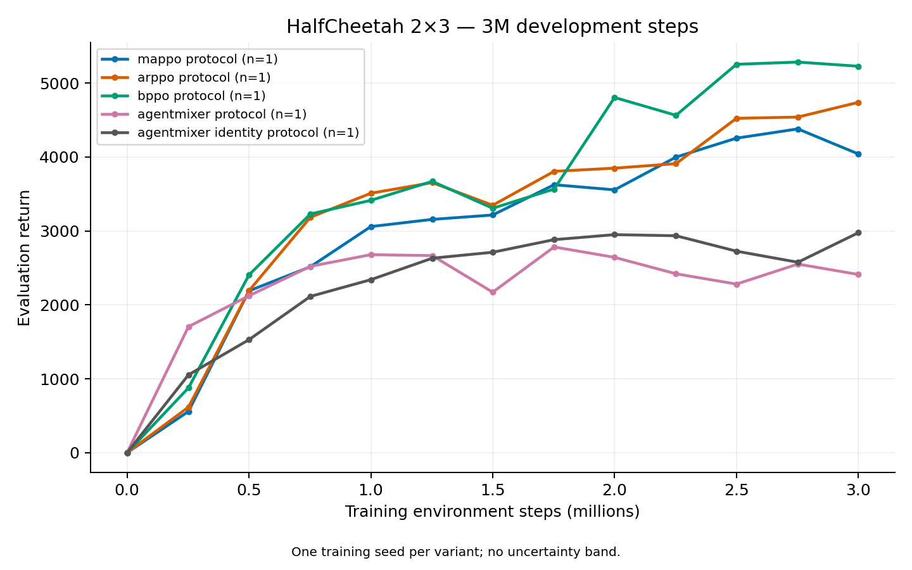

# Completed development experiments — 2026-10-26

All 48 declared runs in the six suites below completed. These are configuration-selection experiments, not independent confirmation of either paper. Except for the noise control, each condition has only training seed 0. The [raw CSV](../experiments/development_results_20261026.csv) contains every run, metric denominator, manifest path, and SHA-256 hashes of its manifest and summary. No failed run is replaced: the earlier SMAC failure remains in its original experiment.

## HalfCheetah 2×3 at 3M transitions

Both suites use observation radius 0, normalized actuator coordinates, a 1,000-step horizon, deterministic local/ordered evaluation, and ten completed evaluation episodes with seed 1,000,000. The normalization-only setting uses 8×100 rollouts, initial standard deviation 1 and normalized MSE. The combined protocol setting uses 40×100 rollouts, initial standard deviation 0.365529, and normalized clipped Huber regression. Thus changes between columns combine several optimization choices. Within a column, method controls share those settings.

| Method | Normalization only | Combined protocol | Protocol − normalization |
| --- | ---: | ---: | ---: |
| MAPPO | 3045.06 | 4041.12 | +996.06 |
| AR-PPO | 3599.84 | 4739.43 | +1139.59 |
| BPPO | 599.40 | 5228.01 | +4628.61 |
| AgentMixer | 2607.24 | 2411.14 | -196.10 |
| AgentMixer identity | 1359.66 | 2975.45 | +1615.78 |

At 3M in this development seed, BPPO exceeds matched AR-PPO by 488.58 (10.31%). AgentMixer is below its identity control by 564.31 (-18.97%). The roughly 5,700 BPPO and 5,040 AgentMixer plotted endpoints are at 10M steps; these 3M values do not establish a paper-budget result or a training-seed advantage.

The final logged joint Gaussian entropy for AgentMixer is −9.3107 over six coordinates, versus −11.1441 for its identity control. Converting the averaged differential entropy to the geometric-mean coordinate scale gives approximately 0.0513 and 0.0378, respectively. These describe the last PPO update and are not evaluation entropies. Both are much smaller than their initial 0.3655 scale. This motivates a controlled variance-parameterization experiment; it does not identify the cause of the performance gap.

## Learning-curve area

The [curve reporter](learning_curve_reports.md) validates all 48 completed runs
and integrates each evaluation curve over its actual training-step coordinates.
The [area CSV](../experiments/curve_summary_20261026.csv) retains every variant,
its seed counts, metric and provenance. Normalized area has the same units as
its evaluation metric; it is an average over training progress, not a new
terminal score.

| HalfCheetah method, combined protocol | Final return at 3M | Normalized curve area, 0–3M |
| --- | ---: | ---: |
| mappo_protocol | 4041.12 | 3042.59 |
| arppo_protocol | 4739.43 | 3290.08 |
| bppo_protocol | 5228.01 | 3580.56 |
| agentmixer_protocol | 2411.14 | 2311.47 |
| agentmixer_identity_protocol | 2975.45 | 2326.86 |

BPPO's normalized area exceeds AR-PPO's by 8.83% in this development seed.
AgentMixer is 0.66% below its identity control in area, compared with an 18.97%
final-return deficit. Their different early/late behavior is visible in the
figure. There is one training seed per curve, so no uncertainty band or
training-seed confidence interval is shown.

[Standalone PDF](figures/hc2x3_protocol3m_20261026.pdf) and
[validated curve data](../experiments/hc2x3_protocol3m_curves_20261026.json).

For the three-seed BPPO noise control, small-batch normalized area is
819.31 ± 480.79 for fresh noise and 1527.80 ± 59.73 for behavior noise.
Under the combined protocol it is 917.77 ± 57.00 and 792.80 ± 309.30,
respectively (sample SD across training seeds). The mixed interaction persists
when evaluating the whole learning curve. Three seeds do not provide the
independent final confirmation required by the experiment plan.

## BPPO Gaussian noise at 500k transitions

Each row uses three development training seeds and five deterministic evaluation episodes per seed. SD is the sample standard deviation across training-seed means, not the within-evaluation episode deviation. The behavior option reconstructs the Gaussian noise paired with the stored action and holds it across PPO epochs.

| Optimization / noise | Seed 0 | Seed 1 | Seed 2 | Mean ± sample SD |
| --- | ---: | ---: | ---: | ---: |
| normalization / fresh | 647.06 | 2632.58 | 2252.51 | 1844.05 ± 1053.90 |
| normalization / behavior | 3082.28 | 2457.87 | 3018.87 | 2853.01 ± 343.67 |
| protocol / fresh | 2399.97 | 2089.26 | 3152.97 | 2547.40 ± 546.97 |
| protocol / behavior | 1604.54 | 2882.13 | 1392.78 | 1959.81 ± 805.73 |

| Paired change: behavior − fresh | Seed 0 | Seed 1 | Seed 2 | Mean change | Relative to fresh mean |
| --- | ---: | ---: | ---: | ---: | ---: |
| normalization | +2435.22 | -174.71 | +766.36 | +1008.96 | +54.71% |
| protocol | -795.43 | +792.87 | -1760.19 | -587.59 | -23.07% |

The interaction is mixed: behavior noise improves 2/3 small-batch seeds and 1/3 combined-protocol seeds. The three-seed sample is exploratory and does not establish statistical superiority. Keep the fresh-noise default for the first longer combined-protocol comparison. Five-episode values need not exactly equal the ten-episode points in the 3M curves.

## Predator–Prey at 1M transitions

All conditions use training seed 0, twenty completed evaluation episodes, and a separate 100×200-step fixed-window evaluation. Windows include auto-resets and rewards from unfinished segments. On 2026-10-26 the author selected the released fixed-window reduction as the primary reproduction comparison. The rates below therefore use the selected metric; the exact historical figure-to-logger mapping remains unverified. The digitized targets at 1M are 2.21 [2.19, 2.23] for penalty 0 and 0.36 [0.35, 0.36] for penalty −1, with geometric reading ranges rather than statistical intervals.

| Variant | Penalty | Episode return | Capture rate | Fixed-window reward / decision |
| --- | ---: | ---: | ---: | ---: |
| agentmixer_factorized_small | 0 | 9.9550 | 100% | 2.06350 |
| agentmixer_joint_small | 0 | 9.9565 | 100% | 1.96550 |
| agentmixer_factorized_batch | 0 | 9.9555 | 100% | 1.91200 |
| agentmixer_joint_batch | 0 | 9.9520 | 100% | 1.99450 |
| agentmixer_factorized_batch_entropy | 0 | 9.9595 | 100% | 2.14200 |
| agentmixer_joint_batch_float64 | 0 | 9.9595 | 100% | 1.88200 |
| arppo_projected_batch | 0 | 9.9425 | 100% | 1.81350 |
| bppo_projected_batch | 0 | 9.3885 | 95% | 1.15400 |
| agentmixer_factorized_small | −1 | -1.2800 | 0% | -0.01000 |
| agentmixer_joint_small | −1 | -1.2800 | 0% | -0.01000 |
| agentmixer_factorized_batch | −1 | -4.9190 | 5% | -0.01155 |
| agentmixer_joint_batch | −1 | -24.8475 | 20% | -0.07335 |
| agentmixer_factorized_batch_entropy | −1 | -3.4625 | 45% | -0.01475 |
| agentmixer_joint_batch_float64 | −1 | -7.1550 | 10% | -0.08195 |
| arppo_projected_batch | −1 | -0.1420 | 15% | -0.02995 |
| bppo_projected_batch | −1 | -1.3065 | 10% | -0.05535 |

Without the penalty, seven variants capture 20/20 evaluation episodes and projected BPPO captures 19/20; the best fixed-window rate is 2.142 in the higher-entropy factorized condition. With penalty −1, all fixed-window rates remain negative. Higher entropy raises capture to 9/20, but the final episode return is still −3.4625 and the rate is −0.01475, below the small-batch avoidance policy’s −0.01. A higher capture fraction alone is not a success criterion. Increasing batch size, entropy, or probability precision has not solved the hard task. Even the best zero-penalty development rate, 2.142, is below the digitized reading range [2.19, 2.23]; no condition clears the selected paper comparison.

## SMAC and Football pilots

SMAC uses 200k training transitions and 32 completed terran 5v5 evaluations. Football uses 100k transitions and 20 complete 3v1 matches. All are development seed 0.

| Method | SMAC return | SMAC wins / 32 | Football return | Football wins / 20 |
| --- | ---: | ---: | ---: | ---: |
| MAPPO | 7.1165 | 1 | 0.8000 | 0 |
| AR-PPO | 8.5083 | 4 | 0.7000 | 0 |
| BPPO | 6.9794 | 0 | 0.8850 | 0 |
| AgentMixer | 7.1253 | 2 | 0.7000 | 0 |
| AgentMixer identity | 6.9252 | 0 | 1.6500 | 0 |

Every SMAC run logged one planned episode-boundary native restart in each of its two training environments and completed beyond the earlier 129,536-step failure point. This supports the runtime correction under training load. The 0–4/32 win counts remain far below final performance evidence. AgentMixer’s 2/32 versus its identity control’s 0/32 is a 6.25-percentage-point difference from one training seed, not a reliable advantage.

All recorded Football evaluation checkpoints have zero wins. Positive checkpoint-shaped reward indicates some field progress without scoring; AgentMixer’s 0.70 return is 0.95 below its identity control. None of these runs establishes football task success.

## Findings and next experiments

1. BPPO learns much better under the combined HalfCheetah settings in seed 0; its 3M return is 10.31% above matched AR-PPO. Run both to 10M in development seeds 0–2 with 32 evaluation episodes, then assess consistency. The chosen settings are already informed by these development results.
2. AgentMixer does not beat its identity control under the same 3M protocol. The completed 1M scale-map control below also gives no terminal mean advantage for either modifier. The completed matched entropy control below improves the bounded variant; the frozen 10M follow-up tests whether that development result persists.
3. Gaussian noise coupling interacts with the optimization settings. Retain all outcomes; do not select behavior noise globally from its favorable small-batch result.
4. Prey penalty −1 remains unsolved. The [frozen-policy behavior diagnosis](prey_behavior_diagnosis.md) reproduces all original evaluation returns and finds frequent blocked greedy actions despite successful recent stochastic training in two small-batch variants. The completed 1,800-episode follow-up confirms successful central sampling and poor local execution, including poor stochastic local execution. Keep both capture and reward metrics; investigate the optimization gap before changing the architecture.
5. SMAC’s native restart correction now passes actual 200k training. A longer learning check can proceed within the measured memory footprint. Football requires longer training before interpreting its zero-win pilot as a final algorithm failure.
6. After selecting configurations, freeze them and use at least five disjoint final training seeds. No experiment here is independent final confirmation.

## Continuous AgentMixer scale-map follow-up

All nine declared 1M-step runs now complete, with scheduler exit 0 for both workers. The [final raw CSV](../experiments/modifier_scale1m_final_20261026.csv) and [validated curves](../experiments/hc2x3_modifier_scale1m_curves_20261026.json) retain every seed and provenance hash. The earlier [six-of-nine snapshot](../experiments/modifier_scale1m_snapshot_20261026.csv) remains unchanged as a dated intermediate artifact.

| Variant | Seed 0 return | Seed 1 return | Seed 2 return | Mean ± sample SD | Normalized area ± sample SD |
| --- | ---: | ---: | ---: | ---: | ---: |
| agentmixer_residual | 2678.96 | 2454.76 | 3033.34 | 2722.35 ± 291.72 | 1990.36 ± 203.79 |
| agentmixer_bounded | 2479.23 | 2593.99 | 2567.26 | 2546.83 ± 60.04 | 1609.44 ± 90.11 |
| agentmixer_identity | 2340.28 | 2768.40 | 3462.16 | 2856.95 ± 566.15 | 1588.42 ± 248.00 |

Bounded replacement does not improve the three-seed mean at 1M: 2546.83 versus 2722.35 for the residual map. Its curve area is also lower, 1609.44 versus 1990.36. It improves the final return in one of the three paired seeds and has a smaller sample SD; this does not establish a preferred final configuration.

Relative to identity, residual has a 4.71% lower final mean but a 25.30% higher normalized area; bounded has a 10.85% lower final mean and a 1.32% higher area. Both modifiers beat identity at the endpoint only in seed 0. Residual has higher area in all three paired seeds. This supports faster early learning in these development runs, not a reliable terminal advantage.

The geometric-mean scale inferred from the final training-update Gaussian entropy is 0.0323–0.0430 for the residual policies and 0.0370–0.0434 for bounded policies. Both families substantially reduce their initial exploration scale. This is a diagnostic over PPO-update observations and epochs, not an evaluation-action variance or proof of the cause of low return.

The released coefficient is zero entropy regularization. The completed
coefficient-0.01 intervention uses the same three variants and seeds 0–2.
The [complete comparison](../experiments/hc2x3_entropy_comparison_complete_20261026.json)
and [verification](../experiments/hc2x3_entropy_complete_verification_20261026.json)
cover all 18 runs, 900 raw evaluation episodes and 4,500 finite updates.
Within each variant, paired configurations differ only in entropy coefficient;
common training source is byte-identical, with an unused reporting module
added in the later snapshot. Earlier partial audits remain unchanged.

| Entropy coefficient | Variant | Final return, mean ± sample SD | Normalized curve area, mean ± sample SD |
| --- | --- | ---: | ---: |
| 0 | Residual | 2722.35 ± 291.72 | 1990.36 ± 203.79 |
| 0 | Bounded | 2546.83 ± 60.04 | 1609.44 ± 90.11 |
| 0 | Identity | 2856.95 ± 566.15 | 1588.42 ± 248.00 |
| 0.01 | Residual | 2770.30 ± 159.66 | 1673.57 ± 52.45 |
| 0.01 | Bounded | 3515.88 ± 238.38 | 1813.75 ± 262.41 |
| 0.01 | Identity | 2812.05 ± 605.42 | 1495.84 ± 267.68 |

Entropy regularization increases bounded-modifier endpoint return by 969.05
and curve area by 204.31 on average, with both improvements in all three
paired seeds. Its effect is mixed for the other variants: residual endpoint
changes by +47.95 but area by −316.79; identity changes by −44.90 and −92.57.
Higher final training entropy and scale occur for all variants, so preserving
exploration does not uniformly improve return. Seed-level data are in the
[CSV](../experiments/hc2x3_entropy_complete_20261026.csv).

At coefficient 0.01, bounded exceeds identity by 703.83 in mean endpoint
return (three of three pairs) and 317.91 in area (two of three). This contrast
also changes the output scale map and initial centralized standard deviation
(0.375 versus 0.365529); it is not an isolated modifier-learning ablation.
Residual versus identity changes only the modifier switch: mean endpoint
−41.75 (one of three wins), mean area +177.73 (two of three).

These are three-seed development comparisons at 1M, below the archived 10M
budget. Analysis began after partial results existed. The residual package
default remains unchanged. The [frozen nine-run 10M follow-up](agentmixer_halfcheetah10m.md)
retains all three variants and tests whether the short-budget ranking persists.
The [BPPO/AR study](halfcheetah_confirmation.md) remains separate evidence.

## Evidence index

| Suite | Scheduler job | Frozen experiment directory |
| --- | --- | --- |
| hc_norm3m | 21196118 | `results/mujoco_hc2x3_valuenorm3m_20261025T083844Z` |
| hc_protocol3m | 21198090 | `results/mujoco_hc2x3_protocol3m_20261025T105407Z` |
| hc_noise500k | 21198169 | `results/mujoco_hc2x3_peer_noise500k_20261025T110353Z` |
| prey1m | 21196495 | `results/prey_batch1m_20261025T090907Z` |
| football100k | 21196497 | `results/football_3v1_pilot100k_20261025T090911Z` |
| smac200k | 21198089 | `results/smac_terran5_learning200k_restart_20261025T105119Z` |

## First two 10M BPPO endpoints (incomplete seed set)

In `mujoco_hc2x3_bppo_ar10m_20261026T082155Z`, BPPO training seeds 0 and 1
complete all 10M transitions with 32 deterministic evaluation episodes each.
Their final means are **5843.80** and **6046.91**. The
[snapshot report](../experiments/hc2x3_bppo_ar10m_snapshot_20261026.json) retains
all six declared runs and refuses both group aggregates while seed 2 and the
matched AR-PPO controls remain unfinished.

Both individual means exceed the figure's digitization reading range
[5660, 5740], whose rounded centerline estimate is 5700. That is a descriptive
point comparison, not a completed reproduction or superiority claim: these
are selected development seeds; the original centerline averages five seeds;
the last plotted vertex is about 9.904M rather than exactly 10M; and the
figure alone does not establish evaluation, smoothing or checkpoint-selection
conventions. The matched baseline and independent final confirmation remain
necessary. No best-checkpoint selection or extrapolation is used here.

## All three BPPO 10M development seeds complete

The subsequent [validated snapshot](../experiments/hc2x3_bppo10m_development_20261026.json)
includes seed 2's final return **6050.40**. BPPO's three-seed mean is now
**5980.37 ± 118.29** (sample SD), median 6046.91. Normalized curve area is
5159.19 ± 150.42. Every declared BPPO curve has the exact budget, matching
configuration/source and evaluation grid; no best checkpoint is selected.

AR-PPO seed 0 also completes with 5726.12. Its remaining two seeds are still
running, so the reporter refuses a baseline group aggregate. BPPO minus AR-PPO
for seed 0 is +117.68 (+2.06%); this one pair cannot establish a method advantage.
All historical comparison qualifications above remain. The
[five-seed confirmation study](halfcheetah_confirmation.md) uses unused seeds,
a separate evaluation stream and the exact selected source snapshot.

## Longer Football pilot: partial 1M results

The first two of five academy 3v1 runs finish at 1M decisions. The
[partial audit](../experiments/football_3v1_1m_progress_20261026.json) verifies
frozen source/configuration hashes, all 200 raw evaluation episodes and 2,500
finite rollout updates. Match wins are recomputed from the native score, and
initial/final summaries match their logged evaluations. Every declared method
remains in the report.

| Method | Final shaped return | Final wins | Elapsed seconds |
| --- | ---: | ---: | ---: |
| MAPPO | 0.8850 | 0/20 | 5196.92 |
| AR-PPO | 0.7000 | 0/20 | 5348.50 |

AR-PPO records one win among 20 episodes at 750,400 decisions, then returns to
zero at the scheduled 1M endpoint. That earlier evaluation remains visible; it
is not substituted for the final result. Positive checkpoint-shaped return does
not establish success. BPPO, AgentMixer and its identity control are unfinished
at this snapshot. These are one-seed development pilots below the 20M paper
budget; no across-method superiority or reproduction claim is supported.

## Completed SMAC 1M pilot, 2026-10-26

All five terran 5v5 controls finish at exactly 1M decisions, training seed 0.
The [complete audit](../experiments/smac_terran5_1m_complete_20261026.json)
checks the frozen source bytes, configurations, versions, 19,535 finite rollout
updates and 1,280 raw evaluation episode records. Native `battle_won` flags,
return reductions, interaction counts, evaluation grids and final summaries
agree. The earlier partial audit remains unchanged.

| Method | Final wins / 32 episodes | Final return | Normalized win-rate curve area |
| --- | ---: | ---: | ---: |
| mappo | 4/32 | 9.722726 | 0.064056 |
| arppo | 0/32 | 8.591813 | 0.035938 |
| bppo | 6/32 | 11.611116 | 0.050775 |
| agentmixer | 2/32 | 7.246001 | 0.067971 |
| agentmixer_identity | 2/32 | 9.875934 | 0.056246 |

BPPO has the largest final win count here, while AgentMixer has the largest
recorded curve area. These are one-seed development observations with only
32 evaluation episodes per checkpoint, below the 10M paper budget. They do
not establish an algorithm advantage or a reproduced paper result. Both
AgentMixer controls finish at 2/32 wins. Larger-batch learning still requires
the separately frozen recurrent integration and runtime/memory checks.
