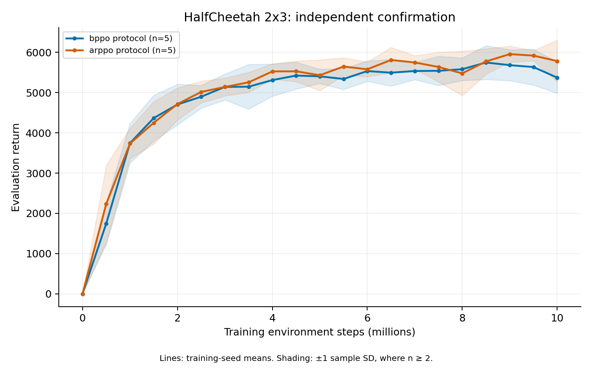

# HalfCheetah 2×3 independent confirmation

## Completed independent result — 2026-10-28

All ten runs are valid, but the frozen BPPO confirmation **fails** its figure-reading criterion. Five fresh BPPO seeds average **5372.06 ± 390.17** (sample SD), compared with the digitized range [5660, 5740]. The whole-seed bootstrap 95% mean interval is [5152.38, 5722.81]. AR-PPO averages **5782.67 ± 516.02**. Paired BPPO minus AR-PPO is −410.62, with interval [−997.55, 304.16]; normalized curve-area difference is −130.65, with interval [−343.60, 37.38]. These intervals do not establish a peer-feedback advantage.

| Fresh training seed | BPPO final return | AR-PPO final return |
| --- | ---: | ---: |
| 1000 | 5202.87 | 5911.78 |
| 1001 | 6055.81 | 5190.83 |
| 1002 | 5080.14 | 6308.34 |
| 1003 | 5223.31 | 5293.04 |
| 1004 | 5298.16 | 6209.38 |

The [frozen-rule report](../experiments/hc2x3_confirmation10m_complete_20261028.json) and [CSV](../experiments/hc2x3_confirmation10m_complete_20261028.csv) retain all seeds. The separate [raw audit](../experiments/hc2x3_confirmation10m_raw_audit_20261028.json) verifies 6,720 evaluation episodes and 25,000 updates, including source/configuration hashes, seeds, optimizer counts and ValueNorm accounting. Both scheduler workers completed with exit 0.

[PDF](figures/confirmation10m_20261028.pdf). Lines are five-training-seed means; shading is one sample SD, not a confidence interval. Development results below remain separate. Failed confirmation seeds are neither replaced nor pooled with development seeds. Any revised configuration requires a new disjoint final seed set.

## Earlier development evidence and frozen protocol

All six development runs complete the 10M-step budget. The
[full audited comparison](../experiments/hc2x3_10m_complete_20261026.json)
verifies the frozen source, 4,032 raw evaluation episodes and 15,000 rollout
updates, including initial/final summary agreement and interaction counts.

| Training seed | BPPO final return | AR-PPO final return | BPPO minus AR-PPO |
| --- | ---: | ---: | ---: |
| 0 | 5843.80 | 5726.12 | +117.68 |
| 1 | 6046.91 | 6058.57 | −11.66 |
| 2 | 6050.40 | 5667.49 | +382.90 |
| Mean ± sample SD | 5980.37 ± 118.29 | 5817.39 ± 210.91 | +162.98 mean difference |

BPPO's mean endpoint is 2.80% higher. Its normalized learning-curve area is
5159.19 ± 150.42 versus 4997.48 ± 217.75, a 3.24% mean increase; the paired area
difference is positive for all three seeds. The endpoint difference is positive
for two seeds. These development results support testing the selected setting
on fresh seeds; three selected seeds do not establish independent superiority.
The earlier partial reports are retained as historical snapshots.

Every BPPO endpoint exceeds the paper figure's reading range [5660, 5740].
This motivates confirmation, not a final reproduction claim. The original
figure averages five training seeds; these three seeds were used during
development. Its last plotted vertex is about 9.904M, and the historical
evaluation, smoothing and checkpoint-selection details remain unverified.
See the [figure audit](curve_targets.md).

## Frozen confirmation

The [training configuration](../configs/mujoco_hc2x3_confirmation10m.json) and
[study record](../experiments/hc2x3_confirmation10m_plan.json) were frozen before
launch. This study changes only the training and evaluation seeds relative to
the selected development settings:

| Item | Choice |
| --- | --- |
| Task | Legacy HalfCheetah-v2, 2×3 agents, observation radius 0, normalized control units, 1,000-step horizon |
| Methods | Corrected BPPO and architecture-matched AR-PPO, five runs each |
| Training seeds | 1000, 1001, 1002, 1003, 1004; absent from all 511 previously prepared runs |
| Training budget | Exactly 10M joint environment decisions per run |
| Evaluation | 32 deterministic complete episodes, separate seed 2,000,000, frozen training observation statistics |
| Primary endpoint | Mean of the five final training-seed evaluation means |
| Other summaries | Median, sample SD, full-budget curve area, paired BPPO minus AR-PPO differences |
| Uncertainty | 10,000 whole-seed bootstrap resamples, private RNG seed 1729, two-sided 95% percentile intervals; preserve pairing for differences |
| Selection | Final scheduled checkpoint; all declared seeds and failures retained |

The evaluation seed was absent from the prepared-run inventory. The 200
derived training-environment seeds (40 environments × five training seeds)
are distinct and exclude the evaluation seed. Both methods use the same seed
pairs. New evaluation episodes do not replace independent training seeds.

The new preparation option `--source-manifest` copies the selected experiment's
19 source modules after verifying every hash. All ten configurations were
validated using that copied code; every resolved field except training and
evaluation seeds matches the corresponding development run. Both launcher
files are also identical to the selected experiment. Later repository changes,
including optional recurrent actors, therefore do not enter this study.

## Decision and cost

Only complete, valid five-seed groups can support a confirmation statement.
A BPPO mean above 5740 is a point comparison with the digitized figure; a lower
95% bootstrap mean endpoint above 5740 supplies stronger evidence under this
pinned reconstruction. Neither criterion resolves unknown historical protocol
differences. Report paired baseline differences separately: passing a paper
threshold does not establish an advantage from peer feedback. Unsuccessful
confirmation seeds are never replaced or pooled with development seeds.

Measured BPPO runtime is 2.73–2.75 hours per 10M run. Five sequential runs per
worker therefore take approximately 13.68 hours at that throughput. The plan
uses two workers, 2 CPUs and 8GB each, with an 18-hour cap. Each worker follows
the matching Ant/Walker worker `21212297_i`, preserving the existing four
serial chains. Scheduler IDs and verified edges belong to
`experiments/jobs.jsonl`; preparing a manifest alone does not submit a job.

The frozen study was subsequently submitted as **21214776**. Both workers were
held until their respective `afterany:21212297_0` and `afterany:21212297_1`
dependencies and resource limits were verified, then released. At submission they were queued behind those predecessors; both workers have now completed.

This is one target's confirmation study. It does not complete the remaining
MuJoCo, SMAC, Football, Predator–Prey or matrix-game release requirements.

Use the [confirmation reporter](simulator_confirmation.md) to check this frozen
study. It validates the original plan and every declared seed before reporting
group statistics, paired baseline differences or a qualified figure comparison.

The later [partition transfer schedule](halfcheetah_partition_transfer.md#pilot-release)
inserts two short500k pilots between each Ant/Walker worker and this study
(21220995 tasks0→2 on A0 and1→3 on A1). Both confirmation workers were pending
when their dependencies changed; the frozen confirmation source, configurations
and training/evaluation seeds are unchanged.
