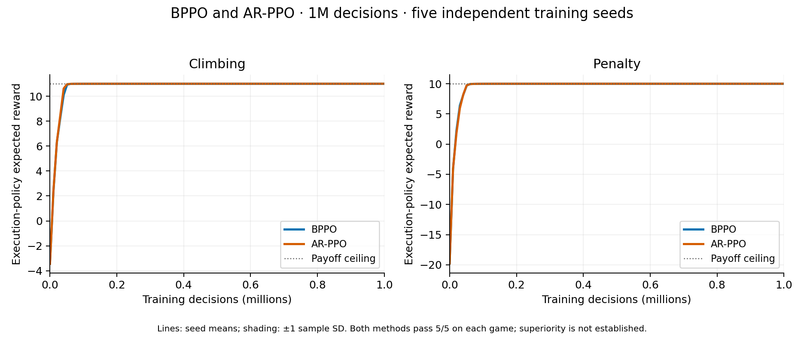

# Matrix configuration validation

The selected configuration uses a 64-dimensional predecessor-action projection
and entropy coefficient 0.1, held for half the budget and linearly reduced to
0.01. Both AR-PPO and BPPO solved both games in all three development seeds at
100,000 decisions. The larger tested coefficient, 0.3, also succeeded; we chose
the smaller coefficient. This is configuration selection, not evidence that
peer feedback outperforms the matched AR-PPO baseline.

Two initial studies were frozen on 2026-10-26, before any of their runs started:

| Study | Methods and games | Seeds | Decisions per run | Purpose |
| --- | --- | --- | --- | --- |
| Independent configuration validation | AR-PPO and BPPO; Climbing and Penalty | 100–109 | 100,000 | Test the selected short-budget configuration on ten unused seeds per method and game |
| Budget extension | Same methods and games | 0, 1, 2 | 1,000,000 | Test the longer entropy schedule on development seeds before selecting a full-budget configuration |

The plans are [100k validation](../experiments/matrix_confirmation100k_plan.json)
and [1M development](../experiments/matrix_budget1m_plan.json). They record every
resolved configuration, source and configuration hashes, the frozen manifest,
software versions, seed inventory audit, metrics and reporting rules. The prior
experiment ledger contained only training seeds 0, 1 and 2. The plans, manifests
and output paths are separate; their results must not be pooled.

The primary score is exact expected execution reward per joint decision,
computed by enumerating all nine actions **only during evaluation**. Greedy
reward and optimal-action probability are reported alongside it. An incidental
optimal argmax at initialization is not evidence of learning. At 100k, the
predeclared BPPO validation criterion requires every seed in each game to
finish, select an optimal greedy action and achieve expected reward at least
95% of the ceiling: 10.45 for Climbing and 9.5 for Penalty. A missing run prevents
a completed validation decision. A failed seed remains in the report and is
not replaced.

Reports include every seed, mean, median, sample standard deviation, bootstrap
uncertainty and paired BPPO-minus-AR-PPO differences. Threshold success counts
use all declared seeds, with Wilson intervals; even ten successes do not imply
perfect population reliability. Full-curve area and the first logged point
after which expected reward stays above 95% are diagnostics. The crossing is
limited to the recorded grid, generally every 10,240 decisions.

The current BPPO and payoff files are byte-identical to the selected development
snapshot. The runner's optimizer extraction preserves the two methods' parameter
ownership and initialization. Its added late learning-rate multiplier defaults
to one, preserving their constant rate. Added AgentMixer and continuous-policy
branches do not apply to these runs. Source hashes distinguish the two snapshots
without silently claiming whole-repository byte identity.

Increasing the budget to 1M changes the entropy hold/decay interval from
50k–100k to 500k–1M. Therefore the longer run is a new development setting, not
an extension of the independent 100k validation claim. Further tuning after
observing validation results must use a new untouched seed set for any later
independent claim.

Neither study alone completes the paper reproduction. The 100k study is below
the BPTA paper budget; the 1M study uses development seeds. Architecture, batch
and epoch settings remain documented reconstruction choices. The historical
matrix figure-to-logger mapping is unresolved, and matrix payoff ceilings
prevent strict improvement in maximum return. Cross-paper sample-efficiency
and algorithm-superiority claims require additional matching and evidence.

## Completed 100k validation

All 40 declared runs complete with valid provenance, budgets and evaluation
records. The frozen BPPO configuration criterion **passes on both games**:
all ten unused training seeds achieve an optimal greedy action and expected
execution reward above 95% of the ceiling. The matched AR-PPO control also
passes in all ten seeds per game. The [complete report](../experiments/matrix_confirmation100k_results_20261026.json)
and [seed-level CSV](../experiments/matrix_confirmation100k_results_20261026.csv)
retain every run, probability-derived scores, audit hashes, curve areas and uncertainty.

| Game | BPPO expected return, mean ± seed SD | AR-PPO expected return, mean ± seed SD | Successes per method |
| --- | ---: | ---: | ---: |
| Climbing, ceiling 11 | 10.998306 ± 0.000359 | 10.997234 ± 0.000960 | 10/10 |
| Penalty, ceiling 10 | 9.994743 ± 0.000582 | 9.992664 ± 0.000803 | 10/10 |

Paired BPPO-minus-AR-PPO endpoint means are +0.001072 for Climbing (95%
bootstrap interval [0.000563, 0.001604]) and +0.002079 for Penalty
([0.001523, 0.002556]). These are small differences near the ceilings:
approximately +0.0097% and +0.0208%. Curve-area means are mixed: BPPO/AR-PPO
8.5463/8.5942 on Climbing and 5.6502/5.6265 on Penalty. The evidence does not
support a broad algorithm-superiority claim.

Each 10/10 success count has a Wilson 95% interval of approximately [0.7225, 1],
not a guarantee of perfect population reliability. This result validates the
selected 100k reconstruction configuration. The separate 1M development study
is reported below, and the report's `paper_reproduction` remains
`not_established` for the reasons above.

## Completed 1M development extension

All 12 declared runs finish, with no integrity errors in the
[full report](../experiments/matrix_budget1m_results_20261026.json) and
[seed-level CSV](../experiments/matrix_budget1m_results_20261026.csv).
Every method/game has three optimal greedy endpoints and three expected-return
threshold successes.

| Game | BPPO expected return, mean ± seed SD | AR-PPO expected return, mean ± seed SD | BPPO / AR-PPO normalized area |
| --- | ---: | ---: | ---: |
| Climbing | 10.999971 ± 0.000027 | 10.999945 ± 0.000021 | 10.753071 / 10.757931 |
| Penalty | 9.999949 ± 0.000017 | 9.999943 ± 0.000002 | 9.564044 / 9.560614 |

The paired mean endpoint differences are +0.0000254 for Climbing (+0.000231%)
and +0.00000604 for Penalty (+0.0000604%). BPPO's area is lower on Climbing and
higher on Penalty. These near-ceiling differences do not support broad
superiority. The longer entropy schedule and development seeds remain separate
from the independent 100k study; the validation decision is `not_assessed` and
paper reproduction is `not_established`.

## Independent 1M confirmation

After all twelve development runs passed, a separate five-seed full-budget
study was frozen. The accepted BPTA source specifies mean and standard deviation
over five training seeds with a fixed sequential execution order. The new study
uses BPPO and matched AR-PPO on both games: **20 runs at 1M decisions**, seeds
**3000–3004**. These seeds are absent from all 533 previously prepared runs
across 48 manifests, including the queued AgentMixer confirmation.

The [plan](../experiments/matrix_confirmation1m_plan.json) retains the exact
eight-module source of the completed 1M development study. Every resolved
configuration field except training seed matches its method/game development
run; the copied trainer validates all twenty configurations and software
versions match. The entropy hold/decay remains 500k–1M. The
[prior-seed inventory](../experiments/matrix_confirmation1m_prior_seeds_20261026.json)
and plan were frozen before launch; no development or 100k outcomes are pooled
into the new confirmation.

All twenty declared runs must complete validly before a completed decision.
Every BPPO seed must select the optimal greedy action and reach exact expected
execution reward at least 10.45 on Climbing or 9.5 on Penalty. AR-PPO outcomes,
paired endpoint differences and normalized curve areas remain separate
comparisons. Report whole-seed bootstrap uncertainty and Wilson success
intervals, retain failures, and do not replace seeds or select earlier peaks.

The [preflight](../experiments/matrix_confirmation1m_preflight_20261026.json)
has no integrity errors and retains all twenty unstarted runs. The reporter's
37 checks include this explicit five-seed/full-budget rule and require the
matched control to finish. The completed result is reported below.

Job **21218775** completed all twenty runs on one serial worker, one CPU, 4GB and a 60-minute cap. Slurm records20m53s and443360KiB peak resident memory for the batch step.
Development runs took 44.34–88.65 seconds each; twenty runs at the measured
maximum would take about 29.55 minutes. The job follows entropy worker
`21211006_1` and precedes Prey worker `21212197_1`, which started after completion.
Its [verified scheduling record](../experiments/matrix_confirmation1m_schedule_20261026.json)
preserves the four-worker ceiling. The job was submitted held and released only
after provenance, preflight, dependency and resource checks.

Matching the budget and seed count does not resolve historical metric or
architecture differences. Both methods solved development seeds, so a special
peer-feedback advantage is not assumed. The report still distinguishes
configuration validation from full paper reproduction and cross-paper sample
efficiency.

## Completed independent 1M confirmation

All 20 declared runs complete with valid provenance, exact budgets and no
integrity errors. The frozen BPPO configuration criterion **passes on both
games**: all five unused training seeds reach an optimal greedy action and at
least 95% of the expected-return ceiling. The matched AR-PPO control also
passes all five seeds in each game. These are separate from development and
100k outcomes. See the [complete audit](../experiments/matrix_confirmation1m_results_20261026.json)
and [seed-level CSV](../experiments/matrix_confirmation1m_results_20261026.csv).

| Game | BPPO expected return, mean ± seed SD | AR-PPO expected return, mean ± seed SD | BPPO / AR-PPO normalized area |
| --- | ---: | ---: | ---: |
| Climbing | 10.999946 ± 0.000046 | 10.999945 ± 0.000041 | 10.750471 / 10.758750 |
| Penalty | 9.999930 ± 0.000021 | 9.999930 ± 0.000048 | 9.563415 / 9.556117 |

Paired endpoint bootstrap intervals include zero: Climbing
[−0.00001869, 0.00002766], Penalty [−0.00004501, 0.00004177]. Both methods
finish near the payoff ceilings; these results do not establish a BPPO
advantage. Curve-area comparisons remain mixed. Each 5/5 success count has a
Wilson 95% interval [0.5655, 1], which does not establish perfect reliability.

This validates the selected reconstruction at the accepted budget and seed
count. The historical metric and architecture qualifications above still apply;
`paper_reproduction` remains `not_established`.

## Reporting

The standard-library-only reporter audits the pre-run plan against its job-ledger
hash, source snapshot, manifest, launcher and configuration files. Completed
runs must match their recorded software versions, start after the freeze,
finish at the declared budget, and contain the exact expected evaluation grid.
It recomputes expected reward, greedy payoff and optimal-action probability
from the frozen payoff table and the nine logged action probabilities. Summary
and final curve values must agree. Missing or invalid runs remain visible;
their groups and paired comparisons are not aggregated. A changed study-level
input invalidates the report without removing declared runs.

```bash
python scripts/report_matrix_validation.py \
  experiments/matrix_confirmation100k_plan.json \
  --output results/matrix_confirmation_report.json \
  --csv results/matrix_confirmation_report.csv
```

Use `experiments/matrix_budget1m_plan.json` and different output names for the
development extension, or `experiments/matrix_confirmation1m_plan.json` for the
new independent full-budget study. Outputs must be new files. The reporter does not query
the scheduler and its `paper_reproduction` field remains `not_established` even
when the specific independent configuration validation passes. Training
metadata's generic matrix-development label is retained; validation context
comes from the independently frozen study plan.

The initial preflight reports are
`results/matrix_confirmation100k_preflight_20261026.json` and
`results/matrix_budget1m_preflight_20261026.json`, each with a CSV. They recorded
all 40 and 12 runs respectively as not started, with no provenance errors.
Jobs `21213329` and `21213330` use the [recorded serial worker
dependencies](worker_schedule.md); the four-worker resource limit is preserved.


## Audited 1M learning curves



Both methods use the selected predecessor-action projection setting. Lines are
means across training seeds 3000–3004; shading is ±1 sample SD, not a confidence
interval. Scores are exact expected team rewards per joint decision. The two
methods nearly overlap after convergence, consistent with the paired endpoint
intervals including zero. This figure validates the selected configurations
and does not establish a BPPO advantage or historical protocol equivalence.

The [PDF](figures/matrix_validation_20261026/bppo_ar_1m.pdf),
[provenance](figures/matrix_validation_20261026/provenance.json) and
[reproduction instructions](learning_curve_reports.md#matrix-validation-figures)
retain the underlying report hashes and all declared seeds.
