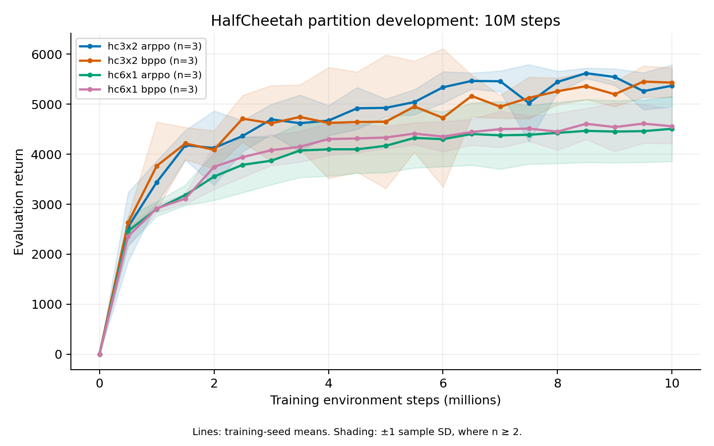

# Progress — 29 October 2026, morning

**Reproduction remains incomplete.** Both HalfCheetah development cohorts have now finished. One partition supports a fresh-seed test; removing entropy did not fix AgentMixer. The full-budget SMAC, Football and remaining MuJoCo studies continue.

## Complete HalfCheetah partition study

All 12 runs completed with scheduler exit 0. The [raw audit](../experiments/hc_partitions10m_complete_20261029.json) verifies 8,064 evaluation episodes and 30,000 updates, including source/configuration hashes, complete budgets, seed streams and optimizer/ValueNorm counts. Results are final 10M deterministic evaluation returns, mean ± sample SD across development seeds 0–2.

| Partition | BPPO | AR-PPO | Mean BPPO − AR | Figure reading range |
| --- | ---: | ---: | ---: | ---: |
| 3×2 | 5431.33 ± 294.34 | 5370.15 ± 420.15 | +61.18 | 4960–5030 |
| 6×1 | 4558.27 ± 342.85 | 4508.08 ± 650.83 | +50.18 | 4550–4610 |

All three 3×2 BPPO endpoints exceed the upper figure-reading bound. Its relative mean gain over AR-PPO is only 1.14%, with two negative seed pairs; mean normalized curve-area difference is −88.62. The 6×1 mean does not exceed its upper reading bound. These observations do not establish an independent result or a consistent peer-feedback advantage. [All seed pairs and curve statistics](../experiments/hc_partitions10m_comparison_20261029.json).

[PDF](figures/hc_partitions10m_20261029.pdf). Shading is sample SD across three training seeds, not a confidence interval. Figure readings come from about 9.904M steps; historical evaluation/smoothing remain unknown.

## Fresh confirmation for 3×2

Job **21279129** registers five new seeds **5000–5004** for each of BPPO and AR-PPO, with evaluation seed **3,000,000**. These IDs were absent from all 782 previously prepared runs. The exact 19-module source and resolved settings are unchanged except training/evaluation seeds. It retains 32 complete evaluation episodes every 500k decisions, a final 10M checkpoint and all failed or unfavorable seeds.

The [revised registration](../experiments/hc3x2_confirmation10m_plan_20261029_v2.json) passes the strict confirmation reporter before release. The first held preflight correctly rejected selecting environment signatures from both 3×2 and 6×1. The revised evidence includes all six 3×2 runs, retaining the full 12-run report separately. No source, configuration, seed, endpoint or job changed, and training had not started during that correction.

The two 1CPU/4GiB/7h workers started after the entropy cohort finished, reusing its slots. A mean above 5030 is a qualified point comparison; a lower whole-seed bootstrap mean bound above 5030 is stronger evidence under this reconstruction. Peer-feedback effects are assessed separately against paired AR-PPO. The failed 2×3 confirmation is retained and cannot be replaced or pooled with this different task.

## Complete entropy comparison: the tested change did not fix AgentMixer

All nine zero-entropy runs completed and pass 9,090 raw episode and 22,500 update checks. All 18 old/new runs have identical sources, runtimes, evaluation grids and settings except entropy coefficient. [Paired comparison](../experiments/hc2x3_entropy10m_comparison_20261029.json).

| Variant | Entropy 0.01, final return | Entropy 0, final return | Mean change |
| --- | ---: | ---: | ---: |
| Bounded modifier | 3819.11 ± 2315.14 | 2938.59 ± 506.43 | −880.52 |
| Identity control | 5569.45 ± 372.68 | 3360.14 ± 346.47 | −2209.31 |
| Residual modifier | 3560.85 ± 679.86 | 3350.29 ± 392.68 | −210.56 |

All three average curve areas also decrease, by 1806.09, 1465.08 and 315.17 respectively. Individual pairs are mixed. Removing entropy does not support the proposed remedy for the modifier gap; this is not proof that entropy alone caused prior instability. No extra entropy sweep or successful AgentMixer reproduction is claimed. Three development seeds are not independent final confirmation, and identity remains a control.

## Portable evidence for community readers

The new [export guide](portable_studies.md) provides a complete-study bundle with exact frozen source, all configurations, metadata, full metric logs, summaries and final checkpoints. It preserves every declared run, including poor outcomes. Operational paths are relative; original evidence bytes remain unchanged. Training and evaluation use the bundled source and new output locations.

Eleven focused tests cover relocation, removal of synthetic original inputs, execution of frozen code, invalid/incomplete studies, tampering and existing-file protection. The actual 12-run HalfCheetah study was exported and moved; all 85 inventoried files verify, and every learning curve and aggregate reproduces exactly from the relocated data. [Verification](../experiments/portable_study_verification_20261029.json).

Native replay is a separate pending check: **21279857** evaluates all 32 final BPPO 3×2 seed-0 episodes from that bundle after the confirmation array finishes. The earlier attempt to insert it before confirmation stopped at its scheduling guard because confirmation had already started; it made no scheduler changes. The replay reuses a freed worker slot and does not modify training.

## Other active studies and scope

The first two Ant global-observation 10M runs are complete and raw-audited: MAPPO 5994.52 and AR-PPO 6410.12. BPPO remains unfinished, so no complete task comparison is reported. All 48 coverage conditions remain declared. [Partial audit](../experiments/mujoco_coverage10m_progress_20261029_am.json).

Football's first two runs reach 14.86M/20M at the snapshot. At 14.8M, MAPPO wins 89/100 matches with return 5.537; AR-PPO wins 44/100 with return 3.730. Their saved log prefixes verify 7,600 episodes and 2,972 updates. These are incomplete baseline results, not BPPO/AgentMixer or final-budget evidence. [Snapshot](../experiments/football20m_progress_20261029_am.json).

Active arrays are Football **21251960**, SMAC **21272799**, MuJoCo **21272800**, and confirmation **21279129**. Native replay **21279857** waits for the complete confirmation array. The schedule remains within eight workers, sixteen CPUs and 96GiB; current training allocations use ten CPUs. Other reproduction work is untouched.

The [coverage snapshot](../experiments/benchmark_coverage_20261029_am.provenance.json) indexes 792 runs across 68 manifests with zero provenance errors. Nine of 45 targets have completed exact-budget method artifacts, including unsuccessful outcomes; 36 still lack them. No full-reproduction or release-ready claim is justified.
